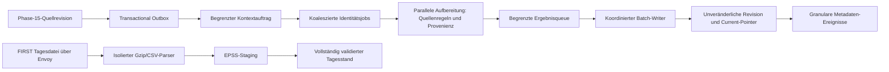

# CVE Enricher – Phase 16

Der geplante Dienst cve-enricher 0.16.0 verwendet Python 3.12, cve-common 0.7.0,
PostgreSQL 18, bestehende Leases/Fencing und Outbox. Es ist der neunte geplante Dienst;
keine weitere Datenbank, Queue oder Workflow-Engine wird ergänzt.

Ein Phase-15-Outbox-Trigger legt atomar einen Kontextauftrag an. Änderungen werden aus
aktuellen und historischen Aliasen des betreffenden Quellrecords abgeleitet, damit entfernte
Zuordnungen ebenfalls neu bewertet werden. Je Auftrag werden höchstens 250 Identitäten
weitergereicht. Gleichartige wartende Identitätsjobs werden koalesziert; laufende Jobs
werden nicht übersprungen, damit Änderungen während ihrer Verarbeitung nicht verloren gehen.
Backfill/Reconcile erfolgt ausdrücklich, mit indexgestützter Keyset-Pagination und begrenzten
Fortsetzungsjobs. Der Dienst führt beim Start keinen ungefragten Vollbackfill aus.

Identitätsjobs lesen unter kurzen Lesesperren einen konsistenten Quellenkontext und geben
die Datenbankverbindung vor der Normalisierung frei. Die Normalisierung arbeitet außerhalb
der Eventloop. Pro Prozess bereiten bis zu vier Jobs parallel Ergebnisse auf und übergeben
diese an eine begrenzte Ergebnisqueue. Ein eigener Writer pro Prozess sammelt Ergebnisse;
identitätsbezogene Sperren schützen überlappende Veröffentlichungen. Unabhängige Pakete
werden von beiden Writern gleichzeitig geschrieben.
Es bleiben drei eigene Container und eine gemeinsame Datenbank ohne zusätzlichen Broker.

Vor der Veröffentlichung sperrt der Writer die Identitäten und Quellpointer und liest deren
Revisionen und Präsenz nach dem Sperrerwerb erneut. Auch der vollständige KEV-Kataloglauf
muss dem aufbereiteten Kontext entsprechen. Bei Änderungen wird der ursprüngliche Job
wiederholt. Eng begrenzte SECURITY-DEFINER-Funktionen liefern nur Lesesperren; die Runtime
erhält keine Schreibrechte auf Rohdaten.

Revisionen, Quellenreferenzen, Assertions, Current-Pointer, Metadatenereignisse und die
gefenceten Jobabschlüsse werden mit mengenorientierten SQL-Abfragen in einer gemeinsamen
Transaktion gespeichert. Gleiche Inputs/Regeln erzeugen keine Doppelrevision; gleiche
Identitäten innerhalb eines Batches erzeugen nur einen Übergang. Ein fehlerhafter oder
veralteter Job führt zum Rollback; der Writer teilt den Batch zur Fehlerisolierung auf.

Die Ergebnisqueue enthält Arbeitsspeicherobjekte, aber keine bereits bestätigten Jobs.
Bis zum Commit bleiben die ursprünglichen PostgreSQL-Jobs mit laufenden Heartbeats offen.
Ein Prozessabbruch verwirft lediglich die Aufbereitung: Lease-Recovery übernimmt den
ursprünglichen Auftrag erneut. Erfolg, Revision und Outbox werden niemals getrennt bestätigt.

EPSS hat einen separaten Importpfad und Current-Dataset-Pointer. Die vollständige Tagesdatei
wird begrenzt über Envoy geladen, SHA-256-geprüft und in einem separaten Prozess gelesen.
Batches werden als Staging persistiert; erst ein fehlerfreies Ende mit vollständigem Gzip/CSV,
Metadaten-, Anzahl-, Identitäts- und Wertecheck aktiviert den Tagesstand. EPSS löst keine
CVE-Massenrevision und keine Matchingaufträge aus.

Die Grenze zu Phase 17 bleibt verbindlich: Produkt-/Paketinformationen sind Evidenz mit
Originalsemantik, keine Aussage über konkrete Serverbetroffenheit. Findings bleiben Phase 18.

Quellenbezogene Reconcile-Jobs verarbeiten ihre begrenzte Liste betroffener Identitäten über dieselbe Aufbereitungsqueue und den Batch-Writer in der gefenceten Abschlusstransaktion. Die bisherige zusätzliche `cve.enrich.record`-Jobstufe pro Identität entfällt dabei. Globale Backfills bleiben in begrenzte Seiten und einzelne Identitätsjobs aufgeteilt. Der native Enricher prüft vor allgemeinen Jobs die separate EPSS-Jobklasse; dadurch wartet der tägliche Feed nicht hinter einem großen CVE-Rückstau. Die gemeinsame Worker-Parallelität bleibt begrenzt und die vorhandene EPSS-Publikationssperre bleibt wirksam.

Git-Quelländerungen werden atomar mit ihrer Persistenz in `cve.enrich.batch`-Pakete
aufgeteilt. Sie erzeugen keine zusätzliche Reconcile-Jobkette pro Datei. Jede Paket-
Aufbereitung lädt ihre gesamten Quellreferenzen mit konstant vielen Abfragen und nutzt
die gleiche revalidierende Ergebnisqueue. Der Paketjob wird erst gemeinsam mit sämtlichen
Revisionen und Outbox-Ereignissen bestätigt. Bereits aktuelle Input-Fingerprints führen
zu einem schreibfreien Ergebnis. EPSS ist optional und standardmäßig deaktiviert.

Mehrere granulare Ereignisse derselben CVE-Version erzeugen nur einen Matching-Auftrag.
Versionswechsel und erneute Veröffentlichung einer älteren Revision bleiben eigenständige
Aufträge. CVSS-/KEV-Prioritätsjobs werden nur für bereits vorhandene Findings angelegt;
deren Erstellung berechnet die aktuelle Priorität selbst. Der globale EPSS-Refresh bleibt
wegen überlappender Finding-Erstellung separat erhalten. Matching-Indizierung bleibt auch
bei leerem Inventar aktiv, damit spätere Inventare den vollständigen CVE-Index verwenden.
