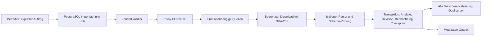

# CVE Importer – Phase 15

`cve-importer` 0.15.0 ist der achte geplante Compose-Dienst. Er verwendet Python 3.12,
cve-common 0.7.0, PostgreSQL 18, die vorhandenen Jobs/Leases und die Transactional Outbox.
Es gibt keinen zusätzlichen Broker, Scheduler, Cache-Dienst oder öffentlichen Import-Endpunkt.

Eine Quelllease verhindert widersprüchliche parallele Läufe derselben Quelle. Andere Quellen
können unabhängig laufen. Jeder Schreibbatch ist an Token, Epoch und Lease des Phase-7-Jobs
gebunden. HTTP und Parser laufen außerhalb von Datenbanktransaktionen. Der Parser hat eigene
CPU-/Speichergrenzen; Archive werden einmal indiziert und mit Rückdruck batchweise gelesen.
Die Parent-Worker-Lease wird währenddessen unabhängig verlängert.

Der Run speichert eingefrorene öffentliche Konfiguration, Modus, Korrelation und technischen
Fortschritt. `progress` ist ein Wiederanlaufcheckpoint, kein erfolgreicher Quellcursor.
Erst nach vollständiger Persistenz aller Seiten, Fenster und Teilströme werden die
`source_streams` und `system.source_sync_state.cursor.importer_v1` gemeinsam fortgeschrieben.
Teilweise gültige Daten bleiben nachvollziehbar erhalten; fehlerhafte Runs erhalten `partial`.

Eine Quelle und ihre externe ID bilden die Identität. Eine gleiche CVE-ID in mehreren Quellen
bezeichnet getrennte Records. Aliase stellen Hinweise dar; es erfolgt keine Zusammenführung.
Die alten Tabellen `cve.records`/`cve.revisions` werden vom Importer nicht beschrieben.
Anreicherung, Matching und Findings sind Folgephasen.

Quellenverträge: [CVEProject](../sources/cveproject.md), [NVD](../sources/nvd.md),
[CISA](../sources/cisa-kev.md), [Ubuntu](../sources/ubuntu.md), [OSV](../sources/osv.md).
Datenmodell: [Records](../database/cve-source-records.md), [Revisionen](../database/cve-revisions.md).
Entscheidung: [ADR-0033](decisions/ADR-0033-source-import-phase15.md).

## Große Erstimporte und Wiederaufnahme

Migration `00034_import_performance` begrenzt die Jobauswahl auf den ersten verfügbaren Kandidaten je registriertem Jobtyp. Die Auswahl erfolgt getrennt für gealterte und neue Jobs über passende Indizes. Die bisherige Reihenfolge (alte Jobs vor neuen, danach Zeit/Priorität) sowie Rollenprüfung, Fencing und `SKIP LOCKED` bleiben bestehen. Ein zusätzlicher partieller Deadline-Index verhindert wiederholte vollständige Warteschlangenscans bei der Lease-Wiederherstellung.

Importer und Enricher verwenden im Compose-Standard jeweils zwei parallele Ausführungen innerhalb des bestehenden Quellencontainers. Die fünf Datenbankverbindungen je Rolle lassen weiterhin Platz für Heartbeats. Netzfilter, Parserisolation und Quellendrosselung bleiben aktiv. Der Parser darf für eine begrenzte Archivseite bis zu 180 Sekunden benötigen, damit ein großer gültiger Batch nicht zum wiederholten Abbruch am selben Prüfpunkt führt.

Die Dashboard-Aktualisierung nimmt einen fehlgeschlagenen, weiterhin geleasten Lauf mit identischer Konfiguration und vorhandenem Fortschritt über einen neuen persistenten Replay-Job wieder auf. Run-ID, Fortschritt, ursprüngliche obere Zeitgrenze und Herkunft bleiben erhalten. Abgeschlossene oder fachlich unvollständige Läufe werden nicht automatisch wiederaufgenommen. Bereits eingespielte Daten werden nicht gelöscht. Für NVD kann `sources.json` die unterstützte Seitengröße `2000` verwenden; die konfigurierte Mindestpause bleibt erhalten.

Der gemeinsame Worker wartet bei vorhandener Arbeit nicht mehr nach jedem Job das Pollingintervall ab. Frei werdende Ausführungsplätze wecken die Schleife sofort; das Pollingintervall begrenzt nur die Abfrage einer leeren Warteschlange. Die periodische Lease-Wiederherstellung läuft weiterhin höchstens einmal pro Pollingintervall. Ein nativer Regressionstest verarbeitet 20 kurze Jobs bei einer Sekunde Leerlaufintervall in weniger als fünf Sekunden und prüft die Parallelitätsgrenze.

Beim kontrollierten Gruppenstopp signalisiert der Supervisor zunächst die Dienst-Hauptprozesse. Diese beenden laufende Jobs gefencet und räumen ihre isolierten Parser auf. Ein gleichzeitiges SIGTERM an die gesamte Prozessgruppe würde Parser vorzeitig beenden und könnte aus einem geplanten Neustart einen fachlich unvollständigen Import machen. Die harte Prozessgruppenbeendigung nach Ablauf der Shutdownfrist bleibt erhalten.

### Betriebsprüfung vom 12.11.2026

Vor der Optimierung lagen rund 249.000 Enrichment-Jobs bereit; die native Jobübernahme überschritt das 15-Sekunden-Zeitlimit. Nach der Umstellung lagen gemessene Medianwerte abhängig von der laufenden Last zwischen etwa 5 und 85 Millisekunden. In einem Betriebsfenster von rund 198 Sekunden entstanden 1.404 weitere aufbereitete Identitäten. Diese Werte messen Warteschlangenübernahme beziehungsweise Nachverarbeitung und sind keine Hochrechnung der gesamten Importdauer. Der Erstimport und externe Abrufgrenzen bleiben relevant.

Nachgewiesen sind 701 allgemeine Tests, 21 Queue-/Worker-Tests, 25 Enrichment-Tests (einschließlich zweier gezielter Regressionstests), fünf native Dashboard-Tests, 54 Quellenvalidierungstests, vier Prozessgruppentests und 38 Frontendtests. Browserprüfung und Prüfungen für Formatierung, Typen, Verträge und Secrets bestehen. Ein zusätzlich versuchter vollständiger Automation-Aufruf enthält neun noch auf die alte Einzelcontainer-Topologie zugeschnittene Dispatcher-Fixtures; diese starten wegen fehlender Gruppenmounts nicht. Der separate Queue-/Worker-Lauf ist vollständig grün.

Die drei eigenen Container verwenden weiterhin genau ein gemeinsames Image; insgesamt bleiben acht CVE-Mon-Container im Einsatz. Herstellerimages, Benutzer-/MFA-Zustand und Nextcloud wurden nicht verändert. Reversible Funktions-/Konfigurationsstände und Laufzustände liegen privat unter `.runtime/import-performance/`; der Betriebsnachweis liegt unter `.runtime/test-reports/import-speed-acceptance.json`. Validierungsfehler werden bei einer gezielten Wiederaufnahme beibehalten; die Wiederaufnahme erklärt einen unvollständigen Bestand nicht automatisch für erfolgreich.
