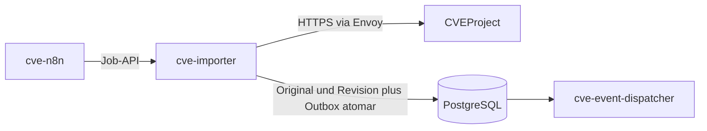
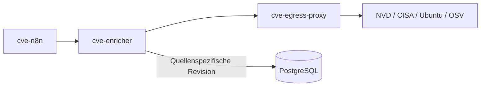
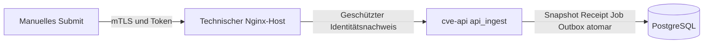
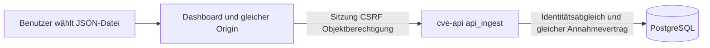
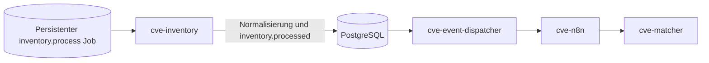
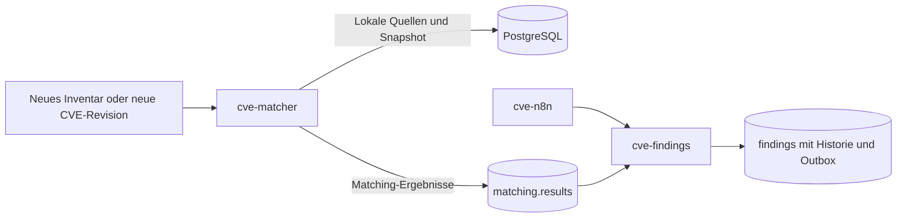
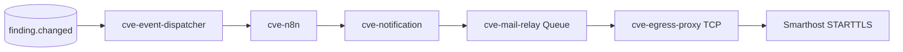
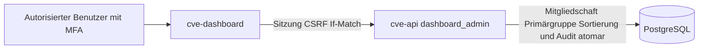
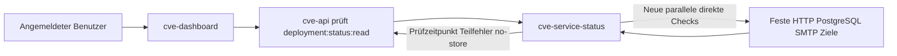

# Datenflüsse T00.01.04

Systemkontext und Containerübersicht stehen in [overview.md](overview.md).

## CVE-Import

CVE-ID/Revision und Quellenhash deduplizieren; Rohdaten lokal halten; Änderungen erzeugen cve.updated.

## Herstellerdatenanreicherung

Original und Ergänzung bleiben unterscheidbar; Retrys respektieren Quoten. Kein Internet im Matcher.

## Technischer Inventar-Upload

Zertifikat und Token gehören zum selben technischen Principal mit serverbezogenem Submit-Recht; unbekannte Server werden abgelehnt.

## Dashboard-Datei-Upload

Multipart enthält ausschließlich server_id und file; Herkunft dashboard_file wird serverseitig vergeben.

## Gemeinsame Inventarverarbeitung

Beide Annahmewege erzeugen denselben Jobtyp. Teil-/Fehlinventare liefern keine negativen Abwesenheitsbeweise.

## Matching und Findings

Neue CVEs erfordern keinen neuen Upload. Ubuntu-Versionsvergleiche berücksichtigen Epoch und Distributionsrevision sowie Hersteller-Backports.

## Alarmierung und E-Mail

Ereignis- und Empfänger-ID deduplizieren. SMTP-Annahme bedeutet nicht garantierte Endzustellung; verlorene Quittung kann Duplikate erzeugen.

## Administrative Gruppenänderung

Keine Kante von Inventarereignissen, Matcher oder n8n in diesen schreibenden Kontext. Gruppenwechsel ändern dynamische Objektberechtigungen, nicht das Inventar.

## Statuspage-Abfrage

Jeder Aufruf prüft neu, begrenzt auf feste Ziele. Die integrierte Seite hängt selbst von Dashboard/API/Auth ab; keine Docker-Abfrage.
