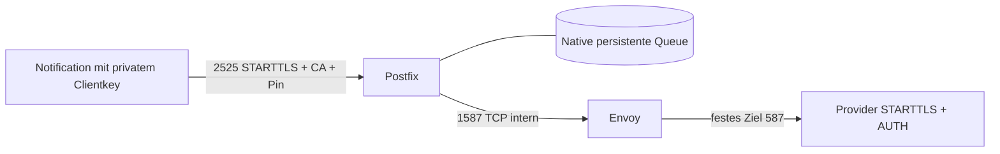

# Mailrelay-Architektur

Postfix liegt ausschließlich in cve_internal/cve_egress_internal, Envoy in beiden
Egressnetzen. Postfix prüft den tatsächlichen Provider-Namen trotz TCP-Zwischenhost.
Keine MX-Zustellung und keine zweite Transportqueue. N ist ein späterer Fachservice.
[ADR-0023](decisions/ADR-0023-postfix-phase05.md),
[Integration](../deployment/postfix.md), [Übergabe](../development/phase-05-handover.md).
