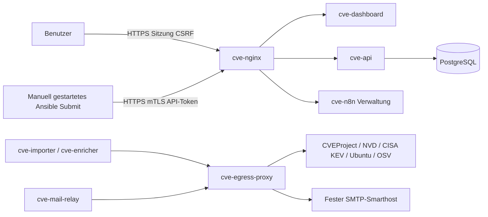
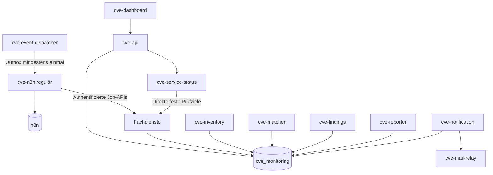

# Gesamtarchitektur T00.01.04

Verbindliche Quelle ist Phase 0 Version 1.0 (nur lokal archiviert).
Alle Diagramme zeigen die Zielarchitektur; die Anwendung ist noch nicht implementiert.
Es gibt einen PostgreSQL-Cluster mit zwei isolierten Datenbanken, reguläres n8n,
persistente Fachjobs und Transactional Outbox. Kein Redis, Broker oder zusätzliche Workflow-Engine.

## Systemkontext

## Komponentenübersicht

[Verantwortungen](responsibilities.md), [Datenflüsse](data-flow.md),
[Netzwerke](networks.md), [DB-Matrix](../database/access-matrix.md).
