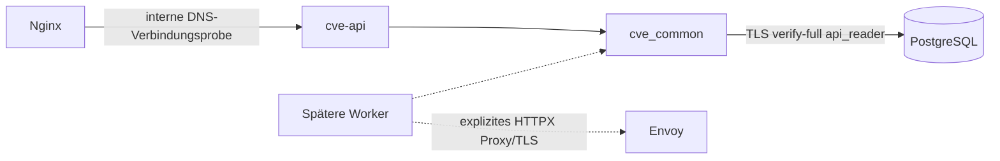

# Technische Python-Microservices

Python 3.12, cve-common/cve-api 0.6.0. Gemeinsame technische Bibliothek als reguläres
src-Paket; API eigenständiges src-Paket mit eigener Projektmetadatei. Kein Runtime-
PYTHONPATH. Root-pyproject bleibt Werkzeugkonfiguration, Mypy-Suchpfade dienen nur
der statischen Zuordnung installierbarer src-Pakete.

API-Dienste verwenden FastAPI/Uvicorn; Worker verwenden Resources/run_worker und
benötigen keine öffentliche REST-API. Dashboard bleibt Phase 20–21, Statusmonitor
Phase 22, Jobs/Outbox Phase 7. Keine fachliche Logik in cve_common, keine gegenseitigen
Fachserviceimports. Kein Redis, Broker oder zweite Workflow-Engine.

## Lebenszyklus und Transaktionen

Importe definieren nur Typen/Fabriken. Settings vor Ressourcen validieren; Lifespan
öffnet pro Dienst einen begrenzten AsyncEngine-Pool. Fehlende private Secrets/CA
verhindern Initialisierung. Der Start erzeugt keine Schemaobjekte und verändert keine
Berechtigungen. Ein vorübergehender DB-Ausfall führt zu Readiness 503, Liveness 200;
keine Background-Polling-Schleife und kein Auto-Migrate beim Dienststart.
AsyncExitStack schließt auch bei Teilfehlern, Shutdown und Cancellation. HTTP-Clients
mit Resources.attach_http registrieren; kein globaler ungeschlossener Client.

`session(database)` erstellt jeweils eine neue AsyncSession und committet nicht.
`transaction(database)` committet nur beim regulären Abschluss; Exception/Cancellation
führt zum Rollback. Transaktionsscope nicht über parallele Tasks teilen. Fachoperation
und spätere Outbox können denselben expliziten Transaktionsscope verwenden; Dispatcher
und Fachoperationen selbst sind hier nicht implementiert. DatabaseRegistry erlaubt
getrennte explizit provisionierte Identitäten, niemals automatische Rollenübernahme
oder Kontextwahl anhand von HTTP-Headern.

[Konfiguration](../security/service-configuration.md),
[DB-Rechte](../security/database-service-access.md),
[Betrieb](../deployment/python-services.md).
